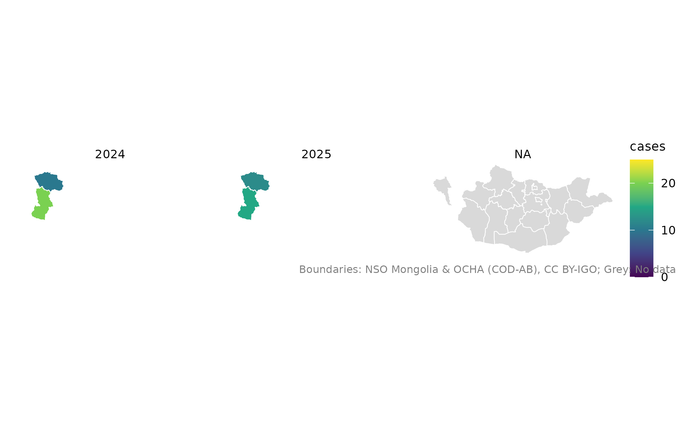
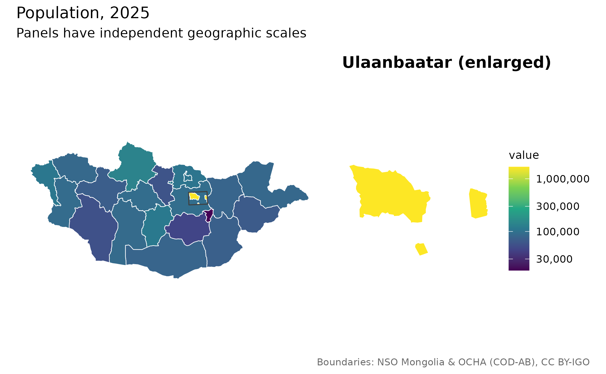
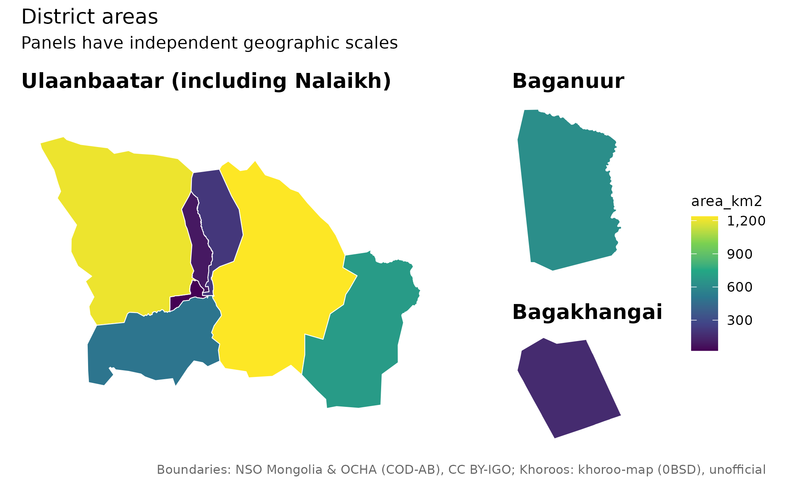
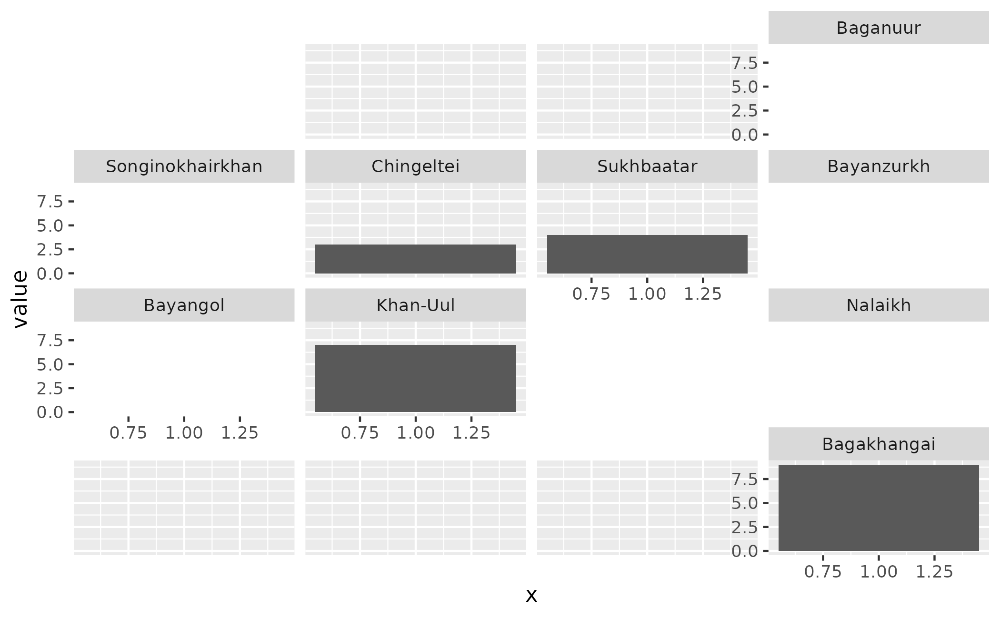

# Auditable joins and comparable maps

``` r

library(mongolmaps)
```

## Keep a record of every join decision

Use codes where possible. When names repeat, supply the parent in a
column or restrict the candidate universe with `within`.

``` r

district <- mn_join(
  data.frame(place = "Bayangol", cases = 12),
  "place", level = "soum", within = "Ulaanbaatar"
)
mn_join_audit(district)[c("row", "x", "pcode", "status", "action")]
#> # A tibble: 1 × 5
#>     row x        pcode  status action
#>   <int> <chr>    <chr>  <chr>  <chr> 
#> 1     1 Bayangol MN1107 exact  joined
```

`mn_match(details = TRUE)` exposes candidates, normalized keys, aliases
and edit distances. A short edit distance is a spelling rule, not a
probability that a match is correct. Strict joins reject
fuzzy/unresolved keys, missing boundaries and duplicate place/stratum
keys.

``` r

observations <- data.frame(
  place = c("Uvs", "Uvs", "Khovd", "Khovd"),
  Year = c(2024, 2025, 2024, 2025),
  cases = c(10, 12, 20, 15)
)
joined <- mn_join(observations, "place", level = "aimag",
                  strata = "Year", strict = TRUE, fuzzy = FALSE)
mn_join_audit(joined)[c("row", "status", "action")]
#> # A tibble: 4 × 3
#>     row status action
#>   <int> <chr>  <chr> 
#> 1     1 exact  joined
#> 2     2 exact  joined
#> 3     3 exact  joined
#> 4     4 exact  joined
```

The audit has one record per **original input row**. Its row numbers do
not refer to rows of a subsequently filtered map. It distinguishes
unmatched keys from known units without geometry, geographic exclusions
and other administrative levels. Audit/provenance attributes can be lost
if an object is rebuilt; save them explicitly for an analysis record.

## Reconcile Ulaanbaatar within statistical strata

NSO codes 5 and 511 sometimes hold complementary capital observations.
Declare all statistical dimensions and the measure columns. Check table
metadata first: this geographic equivalence is not valid for every
table.

``` r

table <- data.frame(
  Region = c("5", "511", "5", "511"),
  Month = c("July", "July", "August", "August"),
  value = c(10, NA, NA, 20)
)
capital <- mn_join(table, "Region", level = "aimag",
                   strata = "Month", value_cols = "value")
#> ℹ Using Ulaanbaatar region values to fill capital data within 1 statistical
#>   stratum/strata.
sf::st_drop_geometry(capital[capital$pcode == "MN11", c("Month", "value")])
#> # A tibble: 2 × 2
#>   Month  value
#> * <chr>  <dbl>
#> 1 July      10
#> 2 August    20
mn_join_audit(capital)[c("row", "x", "action")]
#> # A tibble: 4 × 3
#>     row x     action    
#>   <int> <chr> <chr>     
#> 1     1 5     joined    
#> 2     2 511   superseded
#> 3     3 5     superseded
#> 4     4 511   joined
```

The default prefers a nonmissing capital value and fills missing values
from the region. Conflicts produce a warning. Use `ub_policy = "error"`
to stop on conflicts, `"prefer_region"` to reverse precedence, or
`"none"` to disable this reconciliation. Never sum mixed-level NSO rows
to calculate a retained percentage: totals and their components overlap.

## Separate statistical years from boundary vintages

``` r

mn_vintages()[c("id", "data_version", "geometry_vintage", "authority")]
#> # A tibble: 4 × 4
#>   id         data_version geometry_vintage                             authority
#>   <chr>      <chr>        <chr>                                        <chr>    
#> 1 admin      data-v1      COD 2020; Ulaanbaatar khoroo-derived 2026    official…
#> 2 khoroos    data-v1      2026 source snapshot; effective date unknown unoffici…
#> 3 codes      data-v1      NA                                           source s…
#> 4 admin_high data-v1      COD 2020; Ulaanbaatar khoroo-derived 2026    official…
mn_provenance(mn_khoroos())[c("id", "source_revision", "effective_date")]
#> # A tibble: 2 × 3
#>   id      source_revision                          effective_date
#>   <chr>   <chr>                                    <chr>         
#> 1 khoroos bb1bf18f27e57d7a5aa7fe6d4a17234b40e162c1 NA            
#> 2 codes   2025                                     NA
mn_citation(mn_settlements())
#> [1] "Settlements: Wikidata (CC0)"
```

Only `data-v1` geometry is currently available. Passing another
`boundary_version` to an administrative getter errors instead of
relabeling the available map as a historical boundary. Khoroo geometry
is unofficial and reconciled; its source snapshot date does not
establish its effective date. Historical comparisons need compatible
codes and actual historical geometry or an explicit reallocation
procedure.

## Compare maps using common scales

``` r

mn_map(joined, fill = cases, limits = c(0, 25), breaks = c(0, 10, 20)) +
  ggplot2::facet_wrap(~Year)
```



`bins` accepts interval counts or explicit cut points. Use explicit cut
points for comparisons. `midpoint = 0` gives a diverging scale for
differences. Grey means missing values; zero and missing observations
should be coded separately. Preserve suppression and uncertainty
variables when preparing health statistics; a map does not establish
rate stability.

## Enlarge Ulaanbaatar without moving analytical geometry

``` r

pop <- mn_example_population[mn_example_population$Year == 2025, ]
aimags <- mn_join(pop, "Region", level = "aimag")
#> ℹ Joining at the aimag level; dropped 5 rows for larger units ("country" and
#>   "region") and 2196 rows for smaller units ("soum" and "bag").
mn_inset_ub(aimags, fill = value, trans = "log10",
            title = "Population, 2025")
```



For finer urban data, pass an `ub` map with a fill expression in the
same units as the national data. Limits, breaks and bin cut points are
shared. The panels use independent geographic scales. The UB layout
separates Baganuur and Bagakhangai; its main panel includes Nalaikh.

``` r

mn_map_ub(fill = area_km2, title = "District areas")
```



## Small multiples and population-aware views

Use `mn_aimag_grid` for aimags and `mn_ub_grid` for the nine districts.
Tile positions are approximate geographic layouts, not coordinates.
Per-aimag soum grids are usually more readable than hundreds of national
soum panels.

``` r

grid <- mn_ub_grid
grid$value <- seq_len(nrow(grid))
ggplot2::ggplot(grid, ggplot2::aes(1, value)) +
  ggplot2::geom_col() +
  geofacet::facet_geo(~code, grid = mn_ub_grid, label = "name")
#> Note: You provided a user-specified grid. If this is a generally-useful
#>   grid, please consider submitting it to become a part of the geofacet
#>   package. You can do this easily by calling:
#>   grid_submit(__grid_df_name__)
#> Warning in min(x): no non-missing arguments to min; returning Inf
#> Warning in max(x): no non-missing arguments to max; returning -Inf
#> Warning in min(x): no non-missing arguments to min; returning Inf
#> Warning in max(x): no non-missing arguments to max; returning -Inf
#> Warning in min(x): no non-missing arguments to min; returning Inf
#> Warning in max(x): no non-missing arguments to max; returning -Inf
#> Warning in min(x): no non-missing arguments to min; returning Inf
#> Warning in max(x): no non-missing arguments to max; returning -Inf
#> Warning in min(x): no non-missing arguments to min; returning Inf
#> Warning in max(x): no non-missing arguments to max; returning -Inf
#> Warning in min(x): no non-missing arguments to min; returning Inf
#> Warning in max(x): no non-missing arguments to max; returning -Inf
#> Warning in min(x): no non-missing arguments to min; returning Inf
#> Warning in max(x): no non-missing arguments to max; returning -Inf
```



A Dorling cartogram is an optional alternative: size circles by
population and use colour for an analytically defensible rate. Retain
the original geometry for analysis. Check missing/zero weights,
geographic vintage, and any instability or suppression in the rate
before using this recipe.

``` r

# Optional package: install.packages("cartogram")
# For health rates, prepare compatible numerators and denominators separately.
analysis_map <- sf::st_transform(aimags, mn_crs("albers"))
analysis_map$people_per_km2 <- analysis_map$value / analysis_map$area_km2
display_map <- cartogram::cartogram_dorling(analysis_map, weight = "value")
mn_map(display_map, fill = people_per_km2)
```

## Raster summaries and offline work

Population grids contain **people per cell**. The default
`mn_zonal(r, polygons, fun = "sum")` weights each count by its covered
cell fraction. It assumes a uniform allocation inside each cell. A 1 km
grid cannot recover building-level population. For means, coverage
fractions are not physical area weights on a longitude/latitude grid.
Median summaries require `exact = FALSE`.

Prefer analysis on the native population grid. If
`mn_population(crs = ...)` is used for export, weighted-sum remapping is
normalized to preserve the retained native-grid total. This does **not**
validate local allocations; inspect the `mongolmaps_remapping`
attribute. Raster map resampling is for display only.

``` r

assets <- mn_assets()
assets[assets$id == "worldpop_2025_1km", c("id", "year", "resolution", "url")]
#> # A tibble: 1 × 4
#>   id                 year resolution url                                        
#>   <chr>             <int> <chr>      <chr>                                      
#> 1 worldpop_2025_1km  2025 1km        https://data.worldpop.org/GIS/Population/G…
```

``` r

mn_download(c("admin_high", "worldpop_2025_1km"))
mn_cache_verify()
options(mongolmaps.offline = TRUE)
```

WorldPop files are opt-in, so `mn_download("all")` does not fetch every
year and resolution. Cached downloads are checked against their checksum
by default; old data versions remain until explicitly cleared. Automatic
protected-area refresh keeps a valid stale file if refreshing fails. An
explicit `refresh = TRUE` requires a successful refresh and preserves
the old file on failure.

For cartographic water removal,
[`mn_erase_water()`](https://temuulene.github.io/mongolmaps/dev/reference/mn_erase_water.md)
returns a new geometry and `land_area_km2`, leaving the input and its
`area_km2` unchanged. Land is not the same as inhabited land. When
composing additional layers, combine their credits explicitly, for
example `mn_citation(c("admin", "osm_roads", "osm_water"))`.
