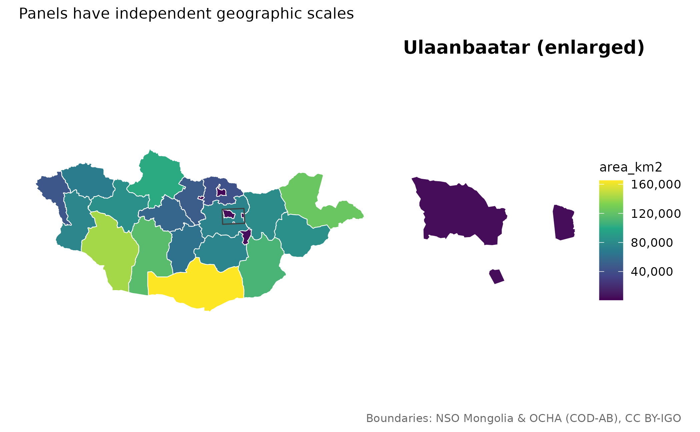
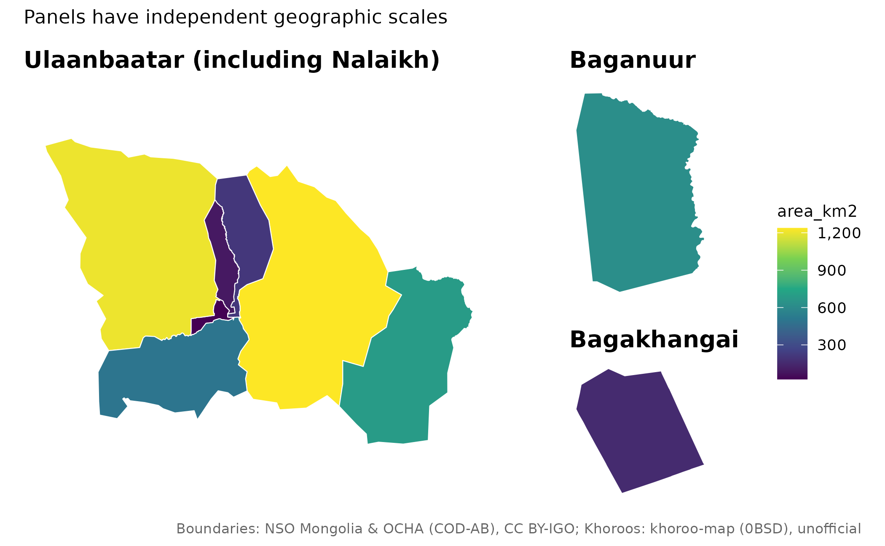

# Шалгаж баталгаажуулах нэгтгэл ба харьцуулах зураг

## Мөр бүрийн шийдвэрийг хадгалах

Боломжтой бол кодоор нэгтгэнэ. Давхардсан нэрд эцэг нэгжийг `by_parent`
баганаар эсвэл `within` хүрээгээр заана.

``` r

x <- mn_join(data.frame(place="Bayangol", cases=12), "place",
             level="soum", within="Ulaanbaatar")
mn_join_audit(x)[c("row","x","pcode","status","action")]
#> # A tibble: 1 × 5
#>     row x        pcode  status action
#>   <int> <chr>    <chr>  <chr>  <chr> 
#> 1     1 Bayangol MN1107 exact  joined
```

`mn_match(details=TRUE)` нь хэвийн болгосон түлхүүр, боломжит нэгж,
тааруулалтын арга, засварын зайг харуулна. Засварын зай нь зөв таарсан
магадлал биш. `strict=TRUE` нь дутуу, таараагүй, ойролцоо түлхүүр,
хилгүй нэгж, давхардсан статистикийн түлхүүрт зогсоно.

## Улаанбаатарын кодыг статистикийн бүлэг бүрд нөхөх

ҮСХ-ны 5, 511 код тухайн хүснэгтэд нийслэлийн ижил статистикийг
илэрхийлж байгааг эхлээд нягтална. Он, сар, хүйс, үзүүлэлт зэрэг бүх
хэмжээсийг `strata`, тоон хэмжигдэхүүнийг `value_cols`-д өгнө.

``` r

d <- data.frame(Region=c("5","511","5","511"),
                 Month=c("July","July","August","August"),
                 value=c(10,NA,NA,20))
x <- mn_join(d,"Region",level="aimag",strata="Month",value_cols="value")
#> ℹ Using Ulaanbaatar region values to fill capital data within 1 statistical
#>   stratum/strata.
sf::st_drop_geometry(x[x$pcode=="MN11",c("Month","value")])
#> # A tibble: 2 × 2
#>   Month  value
#> * <chr>  <dbl>
#> 1 July      10
#> 2 August    20
```

Анхдагчаар нийслэлийн дутуу утгыг бүсээс нөхнө. Зөрүүтэй дутуу бус утгад
анхааруулна. `ub_policy="error"` нь зөрүүнд зогсож, `"none"` нь
нөхөлтийг идэвхгүй болгоно. Нийлбэр болон бүрэлдэхүүн мөрийг давхар
тоолж хадгалсан хувийг тооцож болохгүй.

## Статистикийн он ба хилийн хувилбар

``` r

mn_vintages()[c("id","data_version","geometry_vintage","authority")]
#> # A tibble: 4 × 4
#>   id         data_version geometry_vintage                             authority
#>   <chr>      <chr>        <chr>                                        <chr>    
#> 1 admin      data-v1      COD 2020; Ulaanbaatar khoroo-derived 2026    official…
#> 2 khoroos    data-v1      2026 source snapshot; effective date unknown unoffici…
#> 3 codes      data-v1      NA                                           source s…
#> 4 admin_high data-v1      COD 2020; Ulaanbaatar khoroo-derived 2026    official…
mn_provenance(mn_khoroos())[c("id","source_revision","effective_date")]
#> # A tibble: 2 × 3
#>   id      source_revision                          effective_date
#>   <chr>   <chr>                                    <chr>         
#> 1 khoroos bb1bf18f27e57d7a5aa7fe6d4a17234b40e162c1 NA            
#> 2 codes   2025                                     NA
```

Одоогоор зөвхөн `data-v1` геометр бий. Өөр `boundary_version` өгвөл
алдаа өгнө; өнөөгийн хилийг түүхэн онтой гэж нэрлэхгүй. Хорооны геометр
албан бус, засварлан нэгтгэсэн эхтэй. Эхийн огноо нь хүчин төгөлдөр
болсон огноо биш.

## Томруулсан панель ба нийтлэг өнгөний масштаб

``` r

mn_inset_ub(fill=area_km2)
```



``` r

mn_map_ub(fill=area_km2)
```



Панель бүр газарзүйн тусдаа масштабтай; шинжилгээний координатыг
өөрчлөхгүй. Улсын болон хотын өгөгдөл ижил нэгжтэй байх ёстой. `limits`,
`breaks`, `bins` нь харьцуулах өнгөний масштабыг, `midpoint=0` нь
өөрчлөлтийн хоёр чиглэлийн өнгийг тохируулна.

`mn_aimag_grid` болон `mn_ub_grid` нь ойролцоо газарзүйн тор. Нийт хэдэн
зуун сумын нэг тороос аймаг тус бүрийн жижиг зураг илүү уншихад хялбар.
Хүн амаар хэмжээтэй Dorling тойрог ашиглах жишээг англи гарын авлагаас
үзнэ үү; эх геометр, тогтворгүй түвшин болон нууцалсан утгыг тусад нь
хадгална.

## Растер ба интернетгүй ажиллах

[`mn_zonal()`](https://temuulene.github.io/mongolmaps/mn/reference/mn_zonal.md)
нь нүдний хамрагдсан хувиар жигнэдэг. Нүд дотор хүн ам жигд тархсан гэж
үзэх тул 1 км тороос байшин тус бүрийн хүн амыг гаргахгүй. Дундажийн
нүдний хувийн жин нь бодит талбайн жин биш. Медианд `exact=FALSE`
хэрэглэнэ.

Тооцоололд эх хүн амын торыг ашиглах нь зохистой.
`mn_population(crs=...)` нь жигнэсэн нийлбэрийг эхийн хадгалсан нийт
утгатай тэнцүүлж нормчилно; орон нутгийн хуваарилалтыг
баталгаажуулахгүй. `mongolmaps_remapping` атрибутаас тохируулгыг үзнэ.

``` r

a <- mn_assets()
a[a$id=="worldpop_2025_1km",c("id","year","resolution")]
#> # A tibble: 1 × 3
#>   id                 year resolution
#>   <chr>             <int> <chr>     
#> 1 worldpop_2025_1km  2025 1km
```

WorldPop-ийн он, нарийвчлалыг тусад нь татна.
[`mn_cache_verify()`](https://temuulene.github.io/mongolmaps/mn/reference/mn_cache_dir.md)
кэшийн нийлбэрийг шалгана. Хуучин хувилбарыг тодорхой хүсэлтгүй
устгахгүй. Хамгаалалттай газрын автоматаар шинэчлэх оролдлого бүтэлгүй
бол өмнөх хүчинтэй кэшийг хадгална.

[`mn_erase_water()`](https://temuulene.github.io/mongolmaps/mn/reference/mn_erase_water.md)
нь шинэ геометр болон `land_area_km2` буцааж, оролтын `area_km2`-ийг
хэвээр үлдээнэ. Хуурай газар нь хүн ам амьдардаг газартай адил биш.
Нэмэлт давхаргын эхийг
[`mn_citation()`](https://temuulene.github.io/mongolmaps/mn/reference/mn_sources.md)-аар
тодорхой нэгтгэнэ.
